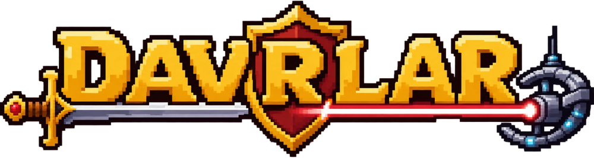

**Davrlar** (узб. «эпохи») — пиксельная стратегия в духе Age of War: 25 веков войны, от римских легионов до орбитальных ударов. Обучайте армию, ставьте башни и переходите в новые эпохи, чтобы разрушить базу противника раньше, чем он разрушит вашу.

- 25 эпох, с I по XXV век, у каждой свои юниты, башни и способности
- три уровня сложности и режим наблюдения за партией ботов
- перемотка до ×16, реплеи партий
- русский, английский и узбекский языки
- два клиента: нативный на Rust и macroquad и браузерный на JavaScript

## Запуск

Нативная версия:

    cd game
    cargo run --release

Браузерная версия:

    npm install
    node tools/build.mjs

Готовая страница появится в `dist/index.html`.

## Управление

| Клавиша | Действие |
|---|---|
| `1` `2` `3` | обучить пехоту, стрелка, тяжёлого |
| `Z` `X` `C` | купить или продать башню |
| `Q` | способность эпохи |
| `E` | перейти в следующую эпоху |
| `Пробел` | пауза |
| `F` | скорость |
| `A` | автоигра |
| `F11` | полный экран |

## Устройство

Симуляция целочисленная и детерминированная: одна и та же партия даёт одинаковый результат в JavaScript и Rust, это проверяется эталонными реплеями.

| Папка | Что внутри |
|---|---|
| `core/` | ядро на JavaScript: симуляция и бот |
| `rust-core/` | порт ядра на Rust |
| `game/` | нативный клиент |
| `client/` | браузерный клиент |
| `data/` | баланс и названия на трёх языках |
| `tools/` | генерация данных, сборка, запекание эффектов |

Подробнее о порте: [RUST_PORT.md](RUST_PORT.md).

## Сторонние компоненты

- [vendor/pixelfx](vendor/pixelfx) — библиотека пиксельных эффектов, лицензия MIT
- шрифт DejaVu из крейта `dejavu`
